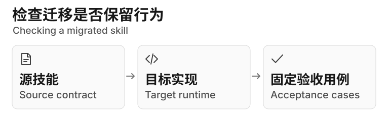

# agentskills-bridge

English · [简体中文](README.md)

Move agent skills between frameworks while preserving their source files. Use rule-based conversion to package an existing skill, or use model-assisted migration to generate and test a target implementation.



## Try a local conversion

From the repository root, use Python 3.10+ and choose a fresh output directory. These commands convert the bundled example and check its preservation manifest.

```sh
python3 cli.py convert examples/agent-fullcycle-engineering --from skill --target crewai --out out/crewai
python3 cli.py verify out/crewai
```

`verify` checks stored file hashes. For a behavioral check, `migrate` derives acceptance cases from the source and runs them against the target framework with `--execute`. A `verified` result requires static, behavioral and native runtime checks. AI migration sends selected source material to the configured provider. Run generated code in an isolated environment with the required framework installed.

[Migration options and example](docs/AI-MIGRATION.md) · [Supported targets](examples/CAPABILITY-MATRIX.md) · [Preservation format](INTERFACE.md) · [MIT license](LICENSE)
