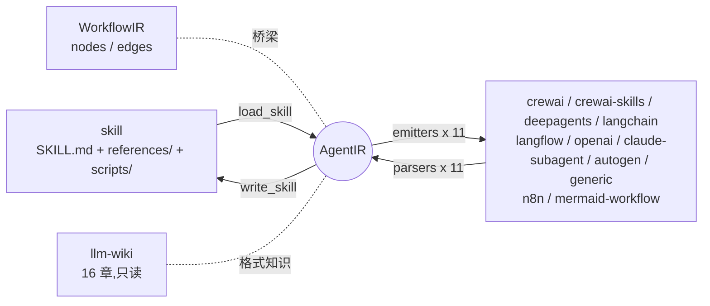

# agentskills-bridge

Skill、Agent、Workflow 三种资产形态之间的双向转换器。一份 SKILL.md 可以转换成 11 种主流框架格式,任何一个框架工程也能还原回 skill;workflow 与 agent 之间同样互转。

[](https://github.com/8eeth0ven/agentskills-bridge/actions/workflows/ci.yml)
[]()
[]()
[]()

```bash
git clone https://github.com/8eeth0ven/agentskills-bridge.git && cd agentskills-bridge

# skill -> 任一框架
python3 cli.py skill2agent examples/agent-fullcycle-engineering --target crewai --out out/crewai

# 任一框架 -> skill(knowledge 原样回流 references/)
python3 cli.py agent2skill out/crewai --from crewai --out out/back

# 任意形态 -> 任意形态,一步
python3 cli.py convert <path> --from n8n --target langchain --out out/x
```



## 解决什么问题

Agent skill(SKILL.md)已经成为跨厂商开放规范,但各家框架的 agent 定义(agents.yaml、agent.py、flow.json、.claude/agents)互不相通。框架虽然陆续支持运行时加载 SKILL.md,skill 资产与框架定义之间仍然没有转换通道:已有 skill 想变成某个框架的工程要手工重写,已有 agent 工程想沉淀成可复用的 skill 同样没有路径。

这个项目用两个中间表示(AgentIR 处理单角色,WorkflowIR 处理节点图)把转换收敛为 O(1) 适配:每种格式只需要一对 emitter 和 parser。SKILL.md 里的编号步骤会被语义提取成工作流节点,而不是整篇当作一个大 prompt。

## 支持的格式

| 格式 | skill 转出产物 | 反向解析入口 |
| --- | --- | --- |
| crewai | `config/agents.yaml` + `tasks.yaml` + `knowledge/` | config 目录,多 agent 项目容错 |
| crewai-skills | CrewAI v1.12+ 原生 `skills/<name>/`,scripts 随目录迁移 | `skills/` 目录 |
| deepagents | `create_deep_agent` 入口 + `skills/<name>/` | 根目录 |
| langchain | 可运行的 `agent.py`,内嵌 prompt 与知识清单 | `.py` 文件 |
| langflow | 可导入的 `flow.json`,1.12 格式 | flow.json |
| openai | Codex 形态 `agents/openai.yaml` + `instructions.md` | 双文件 |
| claude-subagent | `.claude/agents/<name>.md` | frontmatter + 正文 |
| autogen | AG2 `AssistantAgent` 形态 `agent.py` | 自描述常量 |
| generic | `agent.json`,AgentIR 规范序列化 | agent.json |
| n8n | `workflow.json`,AI Agent 节点链,分支拓扑保留 | workflow.json |
| mermaid-workflow | `workflow.md`,GitHub 原生渲染的流程图 | workflow.md |

工具契约(input_schema 与 side_effects)在 8/11 格式往返;其余三种格式没有 schema 挂载点,保留工具名。能力在 11 种格式间的完整保留与降级情况见 [examples/CAPABILITY-MATRIX.md](examples/CAPABILITY-MATRIX.md)。

## 转换质量

全部验证可在 clone 后复现,不需要任何 API key:

```bash
python3 -m unittest discover tests    # 140 个用例:全矩阵 / roundtrip / 边界
python3 evaluation/run_eval.py        # 3 语料 x 11 格式 = 33 链,8 项指标
python3 cli.py wiki verify            # 知识库完整性
```

评测分三层。字符与结构层(F 六项指标 + S_struct + S_terms)当前 33 链全部 1.0000;行为层用真实模型做同题对照,原形态与转换后形态的回答经 judge 判定 17/17 语义一致;运行时层在真实安装的 crewai、langchain、deepagents、autogen、langflow 引擎上加载产物验证(需要框架依赖与可选的环境变量,缺失时自动跳过)。逐项数字、失败分析与方法论见 [evaluation/SCORECARD.md](evaluation/SCORECARD.md),三轮迭代记录见 [evaluation/REPORT.md](evaluation/REPORT.md)。建议自行复现,而不是采信这里的数字。

10 个真实转换案例(含第三方官方仓库输入)见 [examples/SHOWCASE.md](examples/SHOWCASE.md):crewAI-examples 多 agent 项目反向、langflow 官方 fixtures、anthropics 官方 docx skill 的 59 个脚本迁移、分支 DAG 三跳保留等,每个案例附实际输出。

## llm-wiki

`llm-wiki/` 是 16 章的格式知识库,每章一个 markdown,与代码字段名严格同步:概念与两个 IR 的规范、SKILL.md 与各框架格式的字段表、双向转换规则、评测体系定义。`python3 cli.py wiki list` 列出章节,`wiki read` 读正文——它同时是 LLM agent 可以直接消费的文档。

知识库只读,由 `MANIFEST.sha256` 保护,`wiki verify` 校验任何字节级改动。

## 参与贡献

新增一种框架只需要一对 `emit_<fmt>` / `parse_<fmt>` 函数,最小路径见 [CONTRIBUTING.md](CONTRIBUTING.md)。欢迎 Issue 与 PR,中英文均可。

## 相关项目

Agent Skills 生态大致分四层,本项目专注转换与保真评测这一环,与分发安装类工具互补:

- 规范与官方库:[agentskills.io specification](https://agentskills.io/specification),[anthropics/skills](https://github.com/anthropics/skills),[openai/skills](https://github.com/openai/skills),[microsoft/skills](https://github.com/microsoft/skills)
- 分发与安装:[vercel-labs/skills](https://github.com/vercel-labs/skills),[wshobson/agents](https://github.com/wshobson/agents)
- 框架原生 skills 支持:[CrewAI](https://docs.crewai.com)(v1.12+),[LangChain / deepagents](https://docs.langchain.com),[Langflow](https://docs.langflow.org)
- 互操作标准:[AGNTCY OASF](https://github.com/agntcy/oasf),A2A 协议

上游灵感:[8eeth0ven/CrewAI-AgentCodingSkills](https://github.com/8eeth0ven/CrewAI-AgentCodingSkills)。

## License

MIT。
