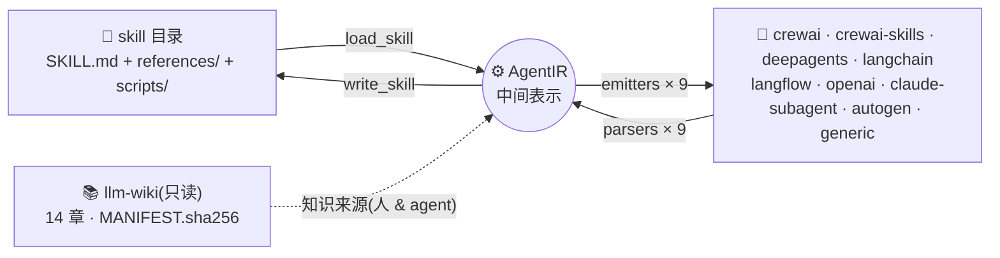

# agentskills-bridge

> **Skill ↔ Agent ↔ Workflow 三形态转换引擎** —— 一份 skill,九种 agent 框架 + 两种 workflow;任何一种形态,一键变成另外两种。  
> Convert between skills, agent framework definitions, and workflows (11 formats). Powered by dual IRs and a local read-only LLM wiki.


把一个 agent skill(`SKILL.md` + `references/` + `agents/openai.yaml`)转换成主流框架的 agent 定义,也能反向还原。所有转换经过中间表示 **AgentIR**(新增框架成本 O(1));格式知识沉淀在只读 **llm-wiki**(人可读,LLM agent 也可读);零强制依赖,Python ≥3.9 直接跑;SKILL.md 输出对齐 [agentskills.io](https://agentskills.io/specification) 开放规范;密钥只经环境变量,永不入库。

```bash
# 一份 skill → 11 种形态;任意形态 → 任意形态一步(convert 万能命令)
python3 cli.py skill2agent ./my-skill --target crewai --out out/crewai
python3 cli.py agent2skill out/crewai --from crewai --out out/back-skill
python3 cli.py convert <任意产物路径> --from n8n --target langchain --out out/任意到任意
```



## 支持格式

| 格式                  | skill → agent 产物                                             | agent → skill 入口              |
| ------------------- | ------------------------------------------------------------ | ----------------------------- |
| **crewai**          | `config/agents.yaml` + `tasks.yaml` + `knowledge/`           | config 目录(多 agent 容错)         |
| **crewai-skills**   | CrewAI v1.12+ 原生 `skills/<name>/` + agents.yaml `skills:` 挂载 | `skills/` 目录(原生保真)            |
| **deepagents**      | LangChain 官方 skills 运行时 `create_deep_agent` 入口 + `skills/`   | 根目录(skills 优先,agent.py 回退)    |
| **langchain**       | 可运行 `agent.py`(内嵌 prompt/知识清单)+ requirements                 | `.py`(自描述常量 + `@tool`)        |
| **langflow**        | 可导入 `flow.json`(1.12 格式:genericNode/œ-handle)+ KB 上传说明       | flow.json(Prompt/Agent 组件提取)  |
| **openai**          | Codex/ChatGPT 形态 `agents/openai.yaml` + `instructions.md`    | 双文件(x-source-skill 保真)        |
| **claude-subagent** | `.claude/agents/<name>.md`(frontmatter + 正文 prompt)          | frontmatter + 正文 + knowledge/ |
| **autogen**         | AG2 `AssistantAgent` 形态 `agent.py`(build_agent 工厂)           | 自描述常量 / 构造参数                  |
| **generic**         | `agent.json`(AgentIR 规范序列化)                                  | 完整还原                          |
| **n8n**             | workflow 形态:`workflow.json`(AI Agent 节点链,Import from File)  | workflow.json(x-source-skill 保真) |
| **mermaid-workflow** | workflow 形态:`workflow.md`(flowchart DAG,GitHub 原生渲染)   | workflow.md(Source Context 保真)  |

前 9 种是 **agent 形态**;后 2 种是 **workflow 形态**——skill / agent / workflow 三种资产经 AgentIR + WorkflowIR 双枢纽互转,任何一种都能变成另外两种(SKILL.md 里的编号步骤会被语义提取为工作流节点)。

## 快速开始

```bash
git clone https://github.com/8eeth0ven/agentskills-bridge.git && cd agentskills-bridge

# 用自带示例(上游仓库的真实 skill)转换
python3 cli.py skill2agent examples/agent-fullcycle-engineering --target crewai --out out/crewai

# 反向 / 查看中间表示 / 只读知识库
python3 cli.py agent2skill out/crewai --from crewai --out out/back-skill
python3 cli.py ir examples/agent-fullcycle-engineering --out out/ir.json
python3 cli.py wiki list && python3 cli.py wiki read 03-frameworks/crewai.md
```

想先看输入→输出长什么样?九个真实转换案例(正向 / 第三方 CrewAI 项目反向 / Langflow 官方 flow 反向 / roundtrip 哈希保真 / 官方 docx 脚本型技能 / 真实 subagent 反向 / 11 节点复杂 flow / 中文全目标 / skill→workflow)见 [examples/SHOWCASE.md](examples/SHOWCASE.md);各能力(scripts、渐进披露、工具契约……)在 11 种形态下的保留情况见 [能力对照矩阵](examples/CAPABILITY-MATRIX.md)。

## 测试与评测

完整报告:[evaluation/REPORT.md](evaluation/REPORT.md)。全部可复现。

**静态保真矩阵** — 3 语料(真实 / 中文边界 / 极简)× 11 格式 = 33 条 roundtrip 链,F_name / F_desc / F_prompt / F_know_q / F_know_c / V_format 六项指标全部 1.0000(基线 F_prompt 0.9189,定位并修复 16 个缺陷后收敛)。复现:`python3 evaluation/run_eval.py`。

**语义验证(三层)** — 字符级之上,标准见 [semantic-equivalence](llm-wiki/05-evaluation/semantic-equivalence.md):L1 结构等价(S_struct:步骤保序/知识集)与 L2 术语保留(S_terms:数字/限定/否定/命令五类)已并入评测矩阵两列(33 链全 1.0);L3 行为等价用真实 LLM 同题对照——原形态 vs 转换后 agent/workflow 形态,glm-4-flash 温度 0.2 下 **10/10 判定语义一致**(探针与协议:`evaluation/behavior/`)。

**真实框架运行时** — 非静态检查,真实安装框架后加载产物:

| 框架                                  | 验证                                                         | 结果    |
| ----------------------------------- | ---------------------------------------------------------- | ----- |
| crewai 1.15.27                      | 真实 `Agent/Task/Crew` 构造;官方 `crewai.skills.load_skill` 加载产物 | 6/6 ✅ |
| langchain 1.4.4 + deepagents 0.7.23 | 生成代码真实导入;假模型跑完整一轮;技能目录加载                                   | 6/6 ✅ |

**真实 LLM 端到端** — GLM 双协议(OpenAI 兼容 × glm-4-flash / Anthropic 兼容 × glm-5.3-flash)× 4 框架产物,统一问题验证 system prompt 与技能目录真实生效,9/9 链全绿(3.9s–9.3s)。复现:`evaluation/runtime/`(依赖或环境变量缺失自动 skip)。

**外部真实语料** — 14 份第三方输入(crewAI-examples、langflow 官方 fixtures、anthropics/skills、真实 Claude subagents,均非本工具生成):反向解析 11/11、正向校验 24/24、保真满分;langflow / openai / claude-subagent 产物与官方结构逐字段 diff 必需级差异归零。复现:`evaluation/external/`、`evaluation/schema_diff.py`。

**回归门禁**:

```bash
python3 -m unittest discover tests   # 70/70
python3 evaluation/run_eval.py       # 33 链全 1.0000
python3 cli.py wiki verify           # 14 章完整性
```

## llm-wiki 只读知识库

14 个章节,每章一个 markdown,与代码字段名严格同步:

- `01-concepts/` — skill vs agent 概念映射、AgentIR 规范
- `02-skill-format/` — SKILL.md / openai.yaml 规范(agentskills.io 对齐)
- `03-frameworks/` — 9 框架格式 + LLM 供应商配置(GLM/OpenAI/Claude 三协议对照)
- `04-conversion/` — 双向转换规则(字段级)
- `05-evaluation/` — 评测体系(指标公式 / corpus / 矩阵 / 局限)

只读三重保护:`Wiki` 类写方法直接抛错 · `MANIFEST.sha256` 完整性清单(`wiki verify`)· `chmod a-w`。

## Roadmap

- [ ] langflow 真实服务端导入回放(docker)
- [ ] openai 产物在真实 Codex CLI 会话加载验证
- [ ] 旗舰档模型(glm-4.6 / GLM-5.3)端到端
- [ ] 多 agent 拓扑(crewai 多 task/multi-crew)双向闭环
- [ ] tools 的 input_schema 全链路往返
- [ ] 外部语料再扩(Codex community plugins / Gemini CLI skills)

## 相关项目

Agent Skills 已成为跨厂商开放规范,本项目专注「skill ⇄ 框架定义」的双向转换与保真评测,与分发/安装类工具互补:

- **规范与官方 skill 库**:[agentskills.io specification](https://agentskills.io/specification) · [anthropics/skills](https://github.com/anthropics/skills) · [openai/skills](https://github.com/openai/skills) · [microsoft/skills](https://github.com/microsoft/skills) · [google-gemini/gemini-skills](https://github.com/google-gemini/gemini-skills)
- **分发与安装**:[vercel-labs/skills](https://github.com/vercel-labs/skills) · [wshobson/agents](https://github.com/wshobson/agents)
- **框架原生 skills 支持**:[CrewAI](https://docs.crewai.com)(v1.12+)· [LangChain / deepagents](https://docs.langchain.com) · [Langflow](https://docs.langflow.org)
- **互操作标准**:[AGNTCY OASF](https://github.com/agntcy/oasf) · A2A 协议

上游灵感:[8eeth0ven/CrewAI-AgentCodingSkills](https://github.com/8eeth0ven/CrewAI-AgentCodingSkills)。

欢迎 Issue / Discussion / PR(中英文都可以)——新增一个框架只需一对 emitter/parser 函数,最小路径见 [CONTRIBUTING.md](CONTRIBUTING.md)。

## License

MIT(与上游一致)。
