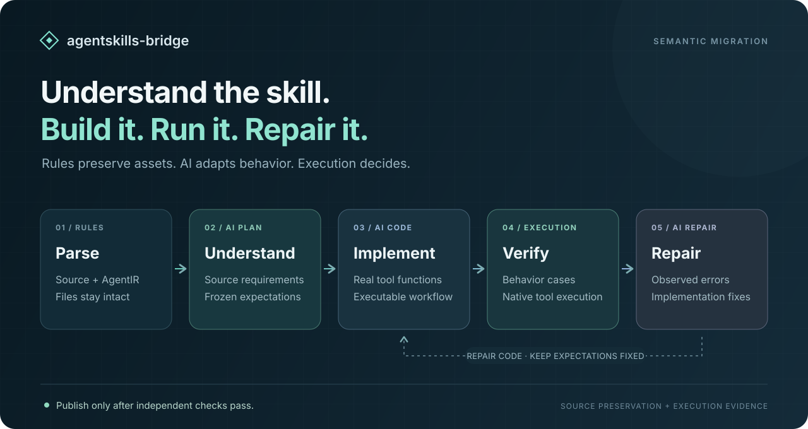
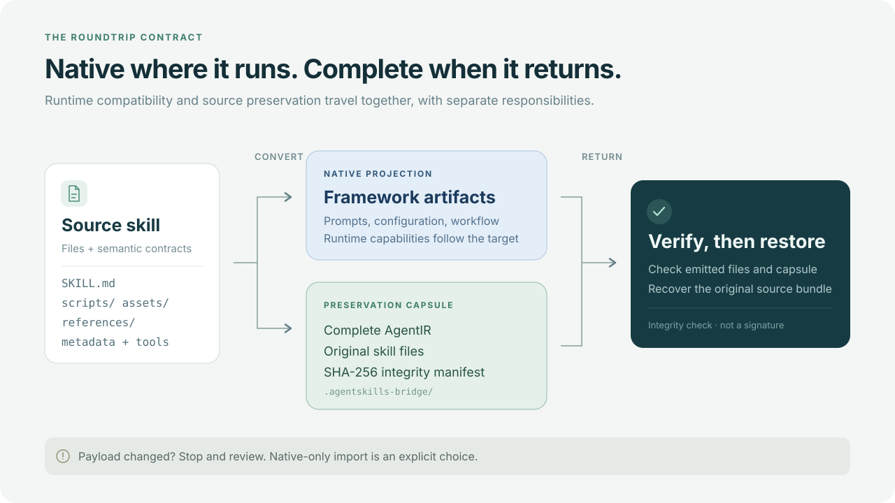

# agentskills-bridge

**把技能迁移成可执行实现，用运行结果推动修复。**

`migrate` 调用真实模型理解源技能、识别框架差异，生成工具与编排代码，再运行冻结的验收用例和目标框架；失败时把实际错误送回模型修复。原有 `convert` 继续提供规则映射与源资产保全。

[](https://www.python.org/downloads/) [](LICENSE)

## 从技能到真实实现



1. **规则解析**：读入技能或原生工程，收集指令、资源、工具契约与现有实现。
2. **AI 分析**：结合目标框架 profile，提取有源文依据的要求、工具、依赖和分支，由独立源码审阅复核验收答案后，再冻结期望。
3. **生成实现**：编写真实 `bridge_tools.py`、`bridge_workflow.py`，接入目标框架；不能用占位函数代替缺失行为。
4. **独立执行**：检查语法与文件结构，运行源要求对应的用例，再通过独立适配器调用目标框架及其真实工具。
5. **错误修复**：把实际失败送回模型修改实现，验收期望保持不变；达到修复次数上限仍失败时，不标记成功。

`verified` 要同时满足静态检查、行为用例和原生运行时验收。保存源文件、生成一份配置或代码可以导入，都不能单独获得这个状态。

## 开始 AI 迁移

转换器本身使用 Python 标准库。AI 迁移需要模型凭据；执行生成项目还需要目标框架依赖。下面以 LangChain 为例，模型名称由你明确指定：

```bash
git clone https://github.com/8eeth0ven/agentskills-bridge.git
cd agentskills-bridge

# 模型凭据只从进程环境变量读取
export ANTHROPIC_API_KEY='<your-api-key>'
export ANTHROPIC_MODEL='<model-id>'

# 为目标框架准备独立运行环境
python3 -m venv .venv-runtime
.venv-runtime/bin/python -m pip install langchain

python3 cli.py migrate examples/order-quote \
  --from skill --target langchain \
  --provider anthropic --model "$ANTHROPIC_MODEL" \
  --python .venv-runtime/bin/python \
  --execute --max-repairs 3 \
  --out out/langchain \
  --report out/migration-report.json
```

这是完整调用方式，不是预先承诺该技能一定能通过：源要求不充分会返回 `needs_input`，依赖或运行宿主未配置会返回 `needs_configuration`。示例技能规定订单校验、折扣和运费分支，不调用外部服务；它是一份迁移输入，不包含预先写好的目标实现。

同时支持 `--provider openai`（Responses API）和 `--provider openai-chat`（兼容 Chat Completions 的接口）。使用对应的 `OPENAI_API_KEY` 与显式 `--model`；自定义端点可通过 `--base-url` 或 provider 的 `BASE_URL` 环境变量配置。详见 [AI 迁移使用说明](docs/AI-MIGRATION.md)。

`--out` 必须是新目录或空目录。只有验收通过才默认发布项目；想检查未通过的代码，加入 `--keep-failed`。不加 `--execute` 只生成和静态检查，返回未验证状态，不能视为迁移成功。

## 验收由谁决定

分析阶段从源内容提取带原文依据的要求，并为要求和工具冻结可执行用例。生成与修复阶段不能修改这些期望、验证器或结果记录。

还可以用 `--acceptance cases.json` 提供自己的 JSON 验收用例。额外用例不会作为验收数组发给首次生成器；请将用例文件放在所选源目录之外，避免它作为普通源资料被读入。修复阶段只接收实际失败反馈。输出中的 `migration.json` 记录要求、冻结计划、每次实现与验证结果、模型调用和使用量。

冻结期望保留在父进程，由父进程比较生成代码返回的实际值。生成代码的调用参数中不包含验收期望。

原生适配器可以注入确定性的模型事件，以真实执行框架工具循环。这能检查工程接线和工具行为，**不等同于生产模型已证明所有业务行为等价**。模型生成、行为验收和框架执行是分开的证据。

## 目标与运行时

所有下列格式都有 AI 生成 profile 和规则转换入口。运行时要求不同：

| 目标 | 主要原生产物 | 原生运行时验收 |
| --- | --- | --- |
| `langchain` | `agent.py` | 独立 Python 适配器，真实 agent 图与工具调用 |
| `deepagents` | `agent.py`、`skills/<name>/` | 独立 Python 适配器，真实 Deep Agents 工具循环 |
| `autogen` | `agent.py` | 独立 Python 适配器，真实 AutoGen AgentChat 调用 |
| `crewai` | `agent.py`、`config/` | 独立 Python 适配器，真实 Crew 与工具调用 |
| `crewai-skills` | `agent.py`、`config/`、`skills/<name>/` | 同上；技能激活与资源使用还需按宿主配置检查 |
| `langflow` | `flow.json` | 配置实际 Langflow 宿主及 `--runtime-command` |
| `n8n` | `workflow.json` | 配置实际 n8n 宿主及 `--runtime-command` |
| `openai` | `agents/openai.yaml`、`instructions.md` | Codex skill 界面形态，需要实际宿主适配命令 |
| `claude-subagent` | `.claude/agents/<name>.md` | 需要实际 Claude Code 宿主适配命令 |
| `generic` | `agent.json` | 数据格式，需要实际消费者适配命令 |
| `mermaid-workflow` | `workflow.md` | 流程文档，需要实际执行宿主适配命令 |
| `skill` | `SKILL.md`、资源目录 | 技能包，需要实际技能宿主适配命令 |

缺少运行时依赖或宿主命令时，Python 工具用例即使通过，也不会替代原生验收。外部宿主命令是用户提供的 argv 适配入口，必须实际运行目标系统并检查其结果，不能用空操作制造成功。

## 规则转换与资产保全

只需要映射格式、运输已有定义或恢复原始资料时，使用不调用 AI 的规则模式：

```bash
python3 cli.py convert examples/agent-fullcycle-engineering \
  --from skill --target crewai --out out/crewai
python3 cli.py agent2skill out/crewai --from crewai --out out/restored
python3 cli.py verify out/crewai
```

Preservation Capsule 将源普通文件、完整 IR 与原生产物哈希一起保存。它负责发现损坏、保留原始字节，不负责证明目标框架执行等价；`verify` 校验完整性，`migrate` 的执行验收判断实现。

## 上下文与执行边界

模型会接收所选源的可读指令、参考内容和实现代码。凭据文件名、常见密钥模式、当前凭据值及本机来源路径会被过滤或遮盖；二进制资源不会转成文本发送。超过上下文限制时明确失败，不会静默截断。请只选择你准备发送给该模型的源资料；capsule 仍保留本地原始资料。

`--execute` 会运行生成代码和你指定的宿主命令。执行器限制时间和输出，并剔除模型凭据环境变量，但它不是操作系统沙箱。使用可信环境，或先在你自己的隔离环境中检查代码；程序不会自动安装模型生成的依赖。

## 文档

- [AI 迁移使用说明](docs/AI-MIGRATION.md)：模型配置、冻结验收、状态与修复流程。
- [Python 接口与保真契约](INTERFACE.md)。
- [格式转换实例](examples/SHOWCASE.md)与[原生能力矩阵](examples/CAPABILITY-MATRIX.md)：规则适配示例。
- [贡献指南](CONTRIBUTING.md)。
- `python3 cli.py wiki list` / `wiki verify`：格式知识库与完整性校验。

[MIT License](LICENSE)
