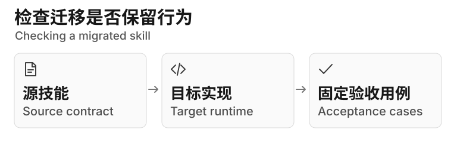

# agentskills-bridge

[English](README.en.md) · 简体中文

把 Agent 技能迁移到另一种框架，并保留原始文件。规则转换可直接生成目标工程；模型辅助迁移还可生成工具代码并运行目标框架的验收用例。



## 试一次本地转换

在仓库根目录使用 Python 3.10+，选择新的输出目录。下面两条命令转换自带示例，再校验保全清单。

```sh
python3 cli.py convert examples/agent-fullcycle-engineering --from skill --target crewai --out out/crewai
python3 cli.py verify out/crewai
```

`verify` 核对已保存文件的哈希。需要检查行为时，`migrate` 从源技能提取并固定验收用例，配合 `--execute` 在目标框架里运行。静态检查、行为用例和原生运行时验收全部通过，结果才会标记为 `verified`。模型辅助迁移会将所选源资料发送给配置的服务，生成代码宜在安装了目标框架的隔离环境中执行。

[迁移选项与示例](docs/AI-MIGRATION.md) · [支持的目标](examples/CAPABILITY-MATRIX.md) · [保全格式](INTERFACE.md) · [MIT 许可证](LICENSE)
