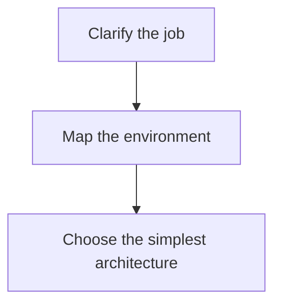

# 转换案例

以下案例全部真实执行,命令可直接复制到仓库根目录复现(零依赖,Python ≥3.9)。

## 案例 1:skill → CrewAI 原生 skills(正向)

把仓库自带的真实 skill([agent-fullcycle-engineering](agent-fullcycle-engineering/SKILL.md))转成 CrewAI v1.12+ 的原生 skills 目录:

```bash
python3 cli.py skill2agent examples/agent-fullcycle-engineering --target crewai-skills --out out/case1
```

产物 16 个文件,布局(摘录):

```text
out/case1/
├── config/agents.yaml          # 含 skills: 挂载字段
├── config/tasks.yaml
├── skills/agent-fullcycle-engineering/
│   ├── SKILL.md                # 合法 Agent Skills 格式,可直接被 crewai 加载
│   └── references/             # 12 篇知识文档原样迁移
└── README.md
```

`config/agents.yaml` 实际内容(摘录):

```yaml
agent-fullcycle-engineering:
  role: |
    Agent Fullcycle Engineering
  goal: |
    End-to-end AI agent engineering workflow for designing, building, debugging,
    testing, evaluating, observing, deploying, and improving LLM or AI agents...
  backstory: |
    # Agent Fullcycle Engineering

    ## Overview

    Use this skill to turn an agent idea into a working, testable, operable system...
  skills:
    - "./skills/agent-fullcycle-engineering"
```

## 案例 2:第三方 CrewAI 项目 → skill(反向)

输入是 **crewAI-examples 官方仓库的真实项目** [screenplay_writer](https://github.com/crewAIInc/crewAI-examples/tree/main/crews/screenplay_writer)(非本工具生成;该项目是多 agent 的):

```bash
# 假设把该项目 clone 到 ./screenplay_writer
python3 cli.py agent2skill ./screenplay_writer --from crewai --out out/case2
```

原 `config/agents.yaml`(第一个 agent,原文):

```yaml
spamfilter:
  role: >
    spamfilter
  goal: >
    Decide whether a text is spam or not.
  backstory: >
    You are an expert spam filter with years of experience. You DETEST advertisements,
    newsletters and vulgar language.
```

生成的 `SKILL.md`(实际输出):

```markdown
---
name: spamfilter
description: Decide whether a text is spam or not.
---

# spamfilter

## Role
spamfilter

## Goal
Decide whether a text is spam or not.

## Backstory
You are an expert spam filter with years of experience. You DETEST advertisements,
newsletters and vulgar language.
```

多 agent 项目取第一个 agent,其余 agent 名完整记录在 `metadata.agents_all`,不丢弃信息。

## 案例 3:Langflow 官方 flow → skill(反向)

输入是 **Langflow 官方测试夹具** [basic_prompting.json](https://github.com/langflow-ai/langflow/blob/main/src/lfx/tests/fixtures/starter_flows/v1.9.0/basic_prompting.json)(v1.9 真实导出格式,非本工具生成):

```bash
python3 cli.py agent2skill ./basic_prompting.json --from langflow --out out/case3
```

生成的 `SKILL.md`(实际输出,完整):

```markdown
---
name: basic-prompting
description: Perform basic prompting with an OpenAI model.
---

Answer the user as if you were a GenAI expert, enthusiastic about helping them
get started building something fresh.
```

## 案例 4:roundtrip 保真(评测演示)

skill 经 langflow(`flow.json` JSON 编码)再完整还原,知识文档逐篇比对哈希:

```python
from converter.skill_loader import load_skill
from converter.emitters import EMITTERS
from converter.parsers import PARSERS
from converter.skill_writer import write_skill

ir_in = load_skill("examples/agent-fullcycle-engineering")
EMITTERS["langflow"](ir_in, "out/case4")           # skill → flow.json
parsed = PARSERS["langflow"](out_dir := "out/case4/flow.json")
write_skill(parsed, "out/case4-back")              # flow.json → skill
```

实际输出:

```text
输入 references: 12 篇
经 langflow(flow.json JSON 编码)再还原后 sha256 一致: 12/12
system_prompt: 输入 12737 字符 → 还原 12737 字符(F_prompt = 1.0)
```

## 案例 5:anthropics 官方 docx skill → skill 目录形态(scripts/ 完整迁移)

输入是 [anthropics/skills](https://github.com/anthropics/skills) 官方仓库的 **docx** skill——脚本驱动型技能(`scripts/` 下 59 个 Python/XML 文件,无 references),最能检验执行资源层的保留:

```bash
# clone 官方仓库后
python3 cli.py skill2agent ./skills/docx --target crewai-skills --out out/case5a
python3 cli.py skill2agent ./skills/docx --target deepagents    --out out/case5b
python3 cli.py skill2agent ./skills/docx --target claude-subagent --out out/case5c
```

实际结果:

```text
crewai-skills:  skills/docx/scripts/ 迁移 59/59 个文件 ✅
deepagents:     skills/docx/scripts/ 迁移 59/59 个文件 ✅
claude-subagent: .claude/agents/docx.md(触发性 description 原样保留)
```

`claude-subagent` 产物头部(实际输出,description 即触发条件):

```yaml
---
name: "docx"
description: "Use this skill whenever the user wants to create, read, edit, or
  manipulate Word documents (.docx files)... If the user asks for a 'report',
  'memo', 'letter'... use this skill."
tools:
  - "Read"
  - "Grep"
  - "Glob"
  - "Bash"
model: "sonnet"
---
```

> 这个案例暴露并修复过一个真实缺陷:早期版本只迁 SKILL.md + references,scripts/ 全丢——由 [能力对照矩阵](CAPABILITY-MATRIX.md) 钉出后修复。脚本型技能优先选 skill 目录形态 target(crewai-skills / deepagents)。

## 案例 6:真实 Claude subagent → skill(反向)

输入是 [wshobson/agents](https://github.com/wshobson/agents) 社区仓库的真实 subagent **backend-architect**(frontmatter 含 `model: inherit` 扩展值):

```bash
python3 cli.py agent2skill ./backend-architect --from claude-subagent --out out/case6
```

原 `.claude/agents/backend-architect.md`(原文)→ 生成的 `SKILL.md`(实际输出),frontmatter 逐字段保留:

```markdown
---
name: backend-development-backend-architect
description: Expert backend architect specializing in scalable API design,
  microservices architecture, and distributed systems... Use PROACTIVELY when
  creating new backend services or APIs.
---

You are a backend system architect specializing in scalable, resilient, and
maintainable backend systems and APIs.

## Purpose

Expert backend architect with comprehensive knowledge of modern API design...
```

## 案例 7:Langflow 官方 research_agent(11 节点复杂 flow)→ skill

比案例 3 更重的输入——官方夹具 [research_agent.json](https://github.com/langflow-ai/langflow/blob/main/src/lfx/tests/fixtures/starter_flows/v1.9.0/research_agent.json)(**11 个节点 / 10 条边**,含 Tool、Search API 组件):

```bash
python3 cli.py agent2skill ./research_agent.json --from langflow --out out/case7
```

成功提取(生成的 SKILL.md 头部,实际输出):

```markdown
---
name: research-agent
description: Agent that generates focused plans, conducts web searches, and
  synthesizes findings into comprehensive reports.
---
```

## 案例 8:中文 skill → 全部 9 种目标 + 逐字节 roundtrip

输入为中文语料(含多级列表、代码块、引号、emoji),一次转全部 9 种目标再从 langflow 产物还原:

```bash
for t in crewai crewai-skills deepagents langchain langflow openai claude-subagent autogen generic; do
  python3 cli.py skill2agent evaluation/corpus/S2_cn --target $t --out out/case8/$t
done
python3 cli.py agent2skill out/case8/langflow --from langflow --out out/case8-back
diff evaluation/corpus/S2_cn/SKILL.md out/case8-back/SKILL.md
```

实际结果:9 个 target 全部成功;`diff` 无输出——**中文 SKILL.md 经 flow.json 编码往返后逐字节一致**。

## 案例 9:skill → workflow(n8n / mermaid-workflow)

输入沿用案例 1 的仓库自带 skill([agent-fullcycle-engineering](agent-fullcycle-engineering/SKILL.md))——它的正文里有一个 9 步的 "Full Lifecycle Workflow" 节,转换器会**语义提取这些步骤**生成工作流(而不是把整篇当一个大 prompt):

```bash
python3 cli.py skill2agent examples/agent-fullcycle-engineering --target n8n --out out/case9-n8n
python3 cli.py skill2agent examples/agent-fullcycle-engineering --target mermaid-workflow --out out/case9-mermaid
```

**n8n 产物实际结果**(workflow.json 可直接 Import from File):**9 个 AI Agent 节点**(type `@n8n/n8n-nodes-langchain.agent`,各节点 `options.systemMessage` = 对应步骤指令)+ Chat Trigger 入口,connections 按步骤顺序成链:

```text
agent 节点: 9 | 链: Chat Trigger → Clarify the job → Map the environment
            → Choose the simplest architecture → Design contracts → ...
首节点 systemMessage: "Clarify the job: user, target outcome, non-goals,
                      allowed actions, success criteria..."
```

**mermaid 产物实际结果**(workflow.md,GitHub 原生渲染;实际 9 节点 8 边,此处摘录前三步,其后每节点一节 `## Step N: <name>` 放该步指令):



**反向**同样可逆:`agent2skill --from n8n`(或 `--from mermaid-workflow`)读回——`x-source-skill` / Source Context 节携带原文全文与 description,roundtrip 六项指标满分(12 篇 knowledge 回流、F_prompt=1.0)。

转换路径:skill_loader → AgentIR →(正文步骤提取 / IR.tasks)→ WorkflowIR → workflow emitters,契约与有损点见 [三形态](../llm-wiki/01-concepts/three-forms.md);能力保留对照见 [能力对照矩阵](CAPABILITY-MATRIX.md) 的 n8n / mermaid-workflow 两列。skill / agent / workflow 三形态至此互转闭环:**任何一种形态都能经 IR 枢纽变成另外两种**。

---

各能力(name/正文/知识/scripts/工具契约)在 11 种形态(9 种 agent + n8n / mermaid-workflow 两种 workflow)下的保留与降级情况,见 [能力对照矩阵](CAPABILITY-MATRIX.md);完整评测见 [evaluation/REPORT.md](../evaluation/REPORT.md)。
